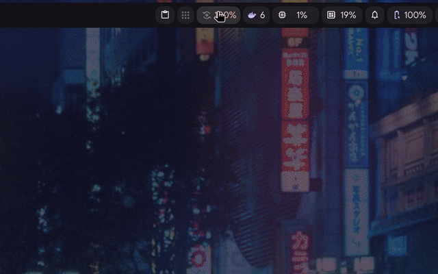
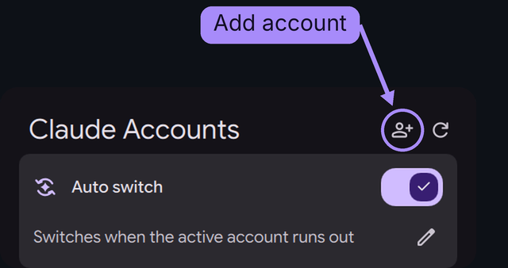

<div align="center">


# Claude Swap

**Switch between multiple Claude Code accounts from the Dux Shell bar.**

A [Dux Shell](https://github.com/duxlabs-dev/dux-shell) (formerly DankMaterialShell) plugin that shows
usage for each Claude Code account, switches the active account with one click, and can switch
automatically when the active account reaches its limit.

[](https://github.com/hfb0/dms-claude-swap/releases/latest)
[](https://github.com/duxlabs-dev/dux-shell)
[](https://github.com/hfb0/dms-claude-swap/actions/workflows/tests.yml)
[](./LICENSE)

[**Preview**](#preview) · [**Installation**](#installation) · [**How it works**](#how-it-works) · [**Support**](#support) · [**Development**](#development)

</div>

## Preview

<div align="center">



</div>

## Overview

Claude Code subscriptions have 5-hour and weekly usage limits. Moving to another account manually
requires `/logout` and `/login`, and there is no single place to see which account still has quota.

Claude Swap uses [claude-swap](https://github.com/realiti4/claude-swap) to keep every account
authenticated and switches between them from the bar. Most usage plugins only display quota;
this one also changes the active account.

## Features

<table>
<tr>
<td width="50%" valign="top">

**Automatic switching**<br />
When enabled, switches to another account once the active account reaches its limit. The pencil
button sets an earlier threshold: 80%, 90%, 95%, or any value from 50 to 100. Selecting an account
manually keeps automatic switching on, unless that account is already past the threshold (it would
be switched away from right away). When every account is exhausted and one comes back early, for
example after a reset granted on claude.ai, the plugin switches to it as soon as claude-swap sees it.

</td>
<td width="50%" valign="top">

**Manual switching**<br />
One card per account with plan, 5-hour usage, weekly usage and per-model weekly limits such as
Fable, when the account has them. Click a card to make that account active. Running Claude Code sessions use the new account from their next request.

</td>
</tr>
<tr>
<td valign="top">

**Usage pace**<br />
A marker on the weekly bars shows the expected usage at a linear pace, and a runner icon with
"Ahead of pace" appears next to the account name when it is far enough ahead to run out before the reset. Hover a bar for
the numbers. Can be turned off in the settings (gear button at the top of the popout).

</td>
<td valign="top">

**Usage alerts**<br />
Desktop notifications at 80% and 95% of a limit (per-model limits included) and when weekly usage
is ahead of pace, only when no other account can take over: with automatic switching on and another
account available, reaching the limit just means a switch. Each alert fires once per reset cycle, and
limits that cross a level together share one notification.

</td>
</tr>
<tr>
<td valign="top">

**Bar widget**<br />
Shows the plugin icon, lit while automatic switching is enabled, and the usage of the limit closest
to running out. The value turns yellow at 80% and red at 95%, matching the alerts. A full style
shows both limits as rings.

</td>
<td valign="top">

**Account management**<br />
Rename accounts from their cards (stored as claude-swap aliases) and add accounts from the popout.
Aliases are used everywhere, including notifications. UI available in English and Brazilian
Portuguese.

</td>
</tr>
</table>

## Installation

**1. Install the plugin** from the Dux Shell plugin store:

```bash
dms plugins install claudeSwap
```

It is also listed under Settings → Plugins and in the [plugin directory](https://duxlabs.dev/plugins).

**2. Install claude-swap**, which stores the accounts and performs the switch. It needs Python 3.12
or newer. With [uv](https://docs.astral.sh/uv/), which downloads a suitable Python when the system
one is older:

```bash
sudo pacman -S uv                                   # Arch
curl -LsSf https://astral.sh/uv/install.sh | sh     # other distributions
uv tool install claude-swap
```

Or with pipx, when the system Python is 3.12 or newer (Arch, Debian 13, Ubuntu 24.04 and later):

```bash
sudo pacman -S python-pipx    # Arch
sudo apt install pipx         # Debian, Ubuntu
pipx ensurepath
pipx install claude-swap
```

Plain `pip install` does not work on these distributions: the system Python is marked as externally
managed (PEP 668). Both methods put `cswap` in `~/.local/bin`, where the plugin looks for it.

**3. Add your accounts.** Click the add-account button at the top of the popout and sign in with
the other account in the browser. Repeat for each account.

<div align="center">

</div>

<details>
<summary>From a terminal</summary>

```bash
cswap add            # 1. save the account you are signed in to
claude auth login    # 2. sign in with the next account (do not log out first)
cswap add            # 3. save that account too
```

</details>

**4. Add the widget** to a bar section under Settings → Plugins.

> [!NOTE]
> Requirements: Dux Shell 2.1.0 or newer, `flock` (util-linux), and Claude Code (`claude`) for the
> add-account flow. That flow opens the terminal configured in Dux Shell (or `$TERMINAL`); the
> plugin settings can override it.

## How it works

- **Switching** runs `cswap switch`. On Linux, Claude Code re-reads its credentials file, so no
  restart is needed.
- **Automatic switching** runs `cswap auto` as a process owned by the shell, so no systemd unit is
  required. A `flock` lock and a single owner instance across bars keep one process running on
  multi-monitor setups.
- **Usage readings** come from claude-swap's cache. It rechecks an account every 3 to 10 minutes
  (an exhausted one about every 10) to stay within the usage endpoint's hourly budget. The refresh
  button makes claude-swap read every account now, so a reset granted on claude.ai shows up right
  away; accounts read in the last 30 seconds, or backing off after an error, are skipped. This goes
  through claude-swap's internals (`force-refresh.py`, run on claude-swap's own Python), so if a
  future release changes them, refresh falls back to the cached reading.
- **Pace** is computed by claude-swap for weekly windows only. An account is marked as ahead when
  it is 15 or more points above a linear pace. The projection is linear, so bursty usage makes it
  less accurate.
- **Network and credentials:** the plugin makes no network requests of its own. claude-swap
  contacts Anthropic (usage and token refresh) and PyPI (update check), and stores credentials in
  files with `0600` permissions.

## Support

The [plugin directory](https://duxlabs.dev/plugins) ranks plugins by the thumbs-up reactions on
their registry issue. A reaction there helps other Dux Shell users find the plugin.

<div align="center">

[](https://github.com/duxlabs-dev/dux-plugin-registry/issues/1163)
[](https://github.com/hfb0/dms-claude-swap/stargazers)

</div>

Bugs and feature requests: [open an issue](https://github.com/hfb0/dms-claude-swap/issues/new).

## Development

Pure logic lives in `ClaudeSwapLogic.qml` (plain functions, no bindings) so it runs under node:

```bash
node --test tests/*.test.js
```

The tests cover JSON parsing, pace and alerts, alias and threshold validation, the shell wrappers
(against a fake `cswap`, including the auto-switch lock), the manifest, and translation coverage.

To update a git checkout:

```bash
git -C ~/.config/DankMaterialShell/plugins/claudeSwap pull
dms restart
```

Dux Shell caches the plugin directory, so new files from an update load only after a restart.

## Disclaimer

Rotating accounts to get around usage limits may go against Anthropic's terms. Use at your own risk.

## Credits

- Inspired by Bogdan Velicu's [DankClaudeUsage](https://github.com/bogdan-velicu/DankClaudeUsage) (MIT, see [THIRD_PARTY_NOTICES.md](./THIRD_PARTY_NOTICES.md)).
- Account switching and usage data come from Onur Cetinkol's [claude-swap](https://github.com/realiti4/claude-swap).

---

<div align="center">
<sub>MIT License</sub>
</div>
